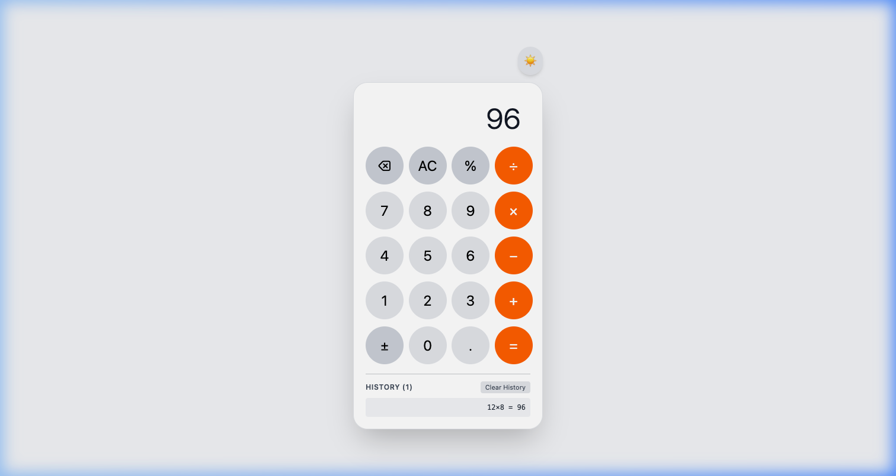

# Calculator (React & Tailwind CSS)

A modern, responsive calculator built with **React 19** and **Tailwind CSS v4**, featuring light/dark mode theming via React Context and calculation history synchronization with `useEffect`.



## Features

- **Theme Toggle (React `useContext`)**:
  - Light and Dark mode toggle button (🌙 / ☀️).
  - Centralized state management through a dedicated `ThemeContext.js`.
  - Reusable, theme-aware `Button` component that dynamically adapts button and chassis styling.
- **Calculation History (React `useEffect`)**:
  - Automatically fetches history when the component mounts (`useEffect`).
  - Updates and fetches history upon clicking `=` and clearing (`AC`).
  - Displays interactive history list with a one-click `Clear History` button.
- **iOS-Inspired UI**:
  - Modern chassis design with rounded corners, drop shadows, and responsive layout.
  - Color-coded keypad with slate gray top row, neutral numeric keys, and vibrant orange operators.
- **Arithmetic & Utility Logic**:
  - Standard arithmetic: Addition (`+`), Subtraction (`−`), Multiplication (`×`), Division (`÷`).
  - Percentage calculations (`%`), sign negation (`±`), single-digit backspace (`⌫`), and All Clear (`AC`).
  - Safe mathematical expression evaluation.

## Tech Stack

- **React 19** (Hooks: `useState`, `useEffect`, `useContext`)
- **Vite 8**
- **Tailwind CSS v4** (`@tailwindcss/vite`)

## Getting Started

1. **Install dependencies:**
   ```bash
   npm install
   ```

2. **Run development server:**
   ```bash
   npm run dev
   ```

3. **Build for production:**
   ```bash
   npm run build
   ```

4. **Lint source code:**
   ```bash
   npm run lint
   ```
